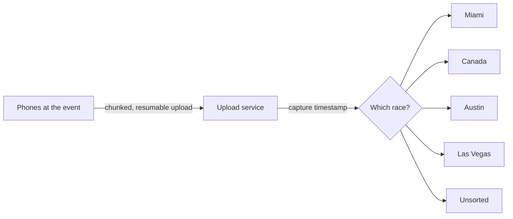

# Crossfade F1 — Event Media Collection

**A SimpleQuick Solutions design tool, for Crossfade Design.**

Live at **https://crossfadef1.parentspad.com**

## What it is
A reusable, phone-friendly upload page for collecting crowd-sourced photos and video at live events. Formula 1 is the first use: fans, crew and contributors open the page on their phones and send their footage straight in. No app, no account, and no race picker.

## How it works
- Contributors pick files on their phone. Large videos upload in resumable chunks, so a dropped connection picks up where it left off.
- Media lands in private cloud storage (OneDrive), not in this repo.
- The server reads each file's **capture timestamp** and sorts it automatically into Crossfade's four races each year: **Miami, Canada (Montreal), Austin (COTA) and Las Vegas**. Anything outside those windows, prep shots included, goes to **Unsorted**.

## Intent and vision
The tool is built to be reused for future events with different audiences. The bigger goal is **consolidating media from many sources and contributors into one organized place**, so that editing into short-form and long-form videos can start on command. When Steven says start, the footage is already there and sorted, ready for the editor to cut.

## Stack
Static page on GitHub Pages (HTML/JS, EXIF and MP4 date reading in the browser). Google Apps Script backend. Microsoft Graph resumable upload sessions into OneDrive.

## Roadmap
- Reuse for other events and clients with custom branding and sort rules
- Pull in more media sources beyond phone uploads
- Hand-off into the editing pipeline for short- and long-form cuts

---
This repo holds only the public upload page. Uploaded media and the backend stay private. This README is updated as the project progresses.
